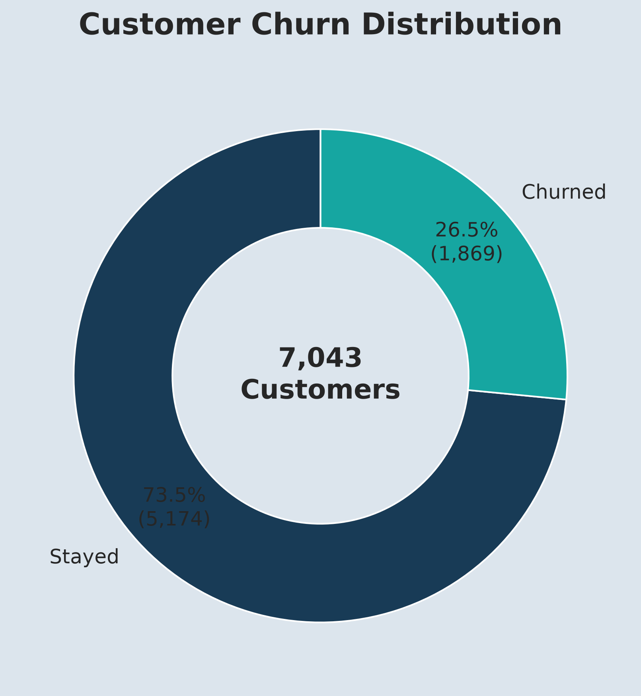
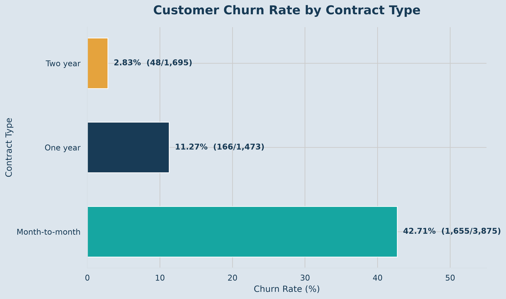
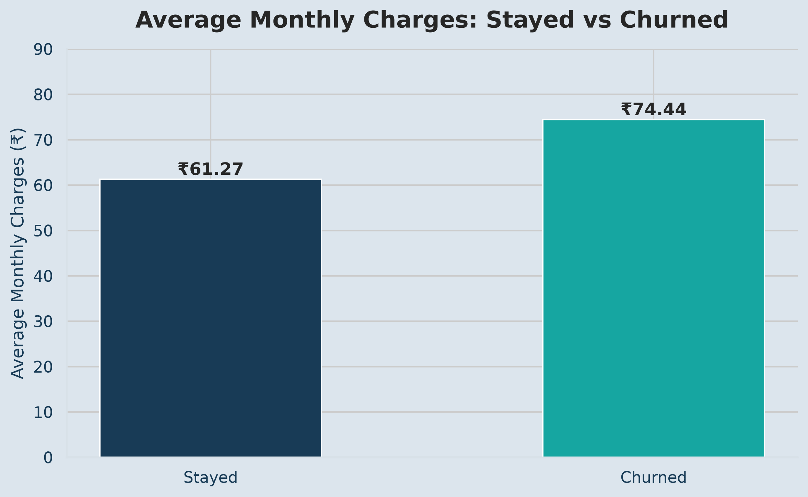
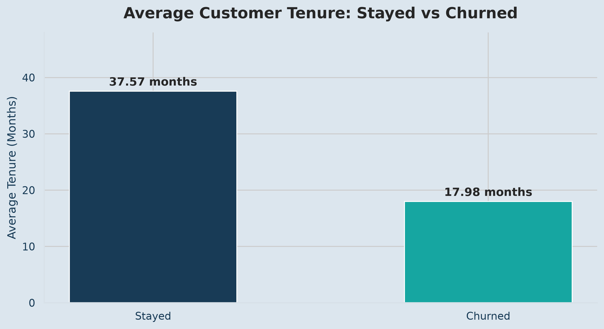
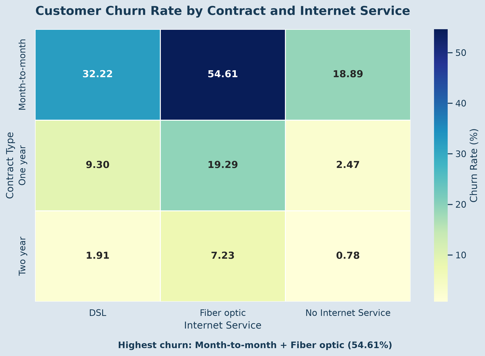
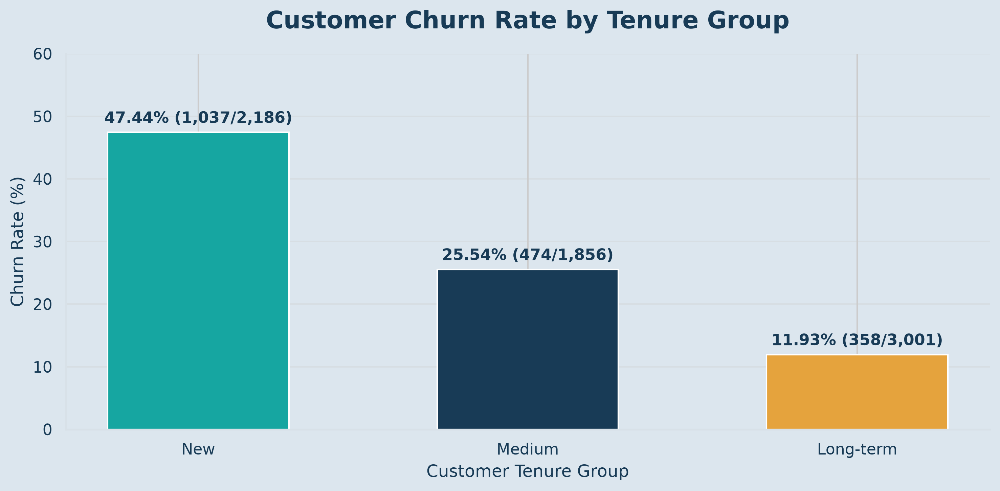

# Customer Churn Analysis & Retention Insights

## Project Overview

This project analyses customer churn in a telecommunications company using Python, Pandas and data visualization. The objective is to identify high-risk customer segments, understand churn patterns and recommend practical customer-retention strategies.

## Business Problem

Customer churn affects revenue and long-term business growth. This project investigates:

- Which customer segments have the highest churn rates?
- How do contract types relate to customer retention?
- Is customer tenure associated with churn?
- How do monthly charges differ between customers who stay and leave?
- Which customer groups should the business prioritise for retention?

## Dataset

- **Source:** IBM Telco Customer Churn Dataset
- **Total customers:** 7,043
- **Total columns:** 21
- **Target variable:** Churn
- **Original dataset:** `Telco-Customer-Churn.csv`
- **Cleaned dataset:** `Telco-Customer-Churn-Cleaned.csv`

Dataset source: https://github.com/IBM/telco-customer-churn-on-icp4d/blob/master/data/Telco-Customer-Churn.csv

## Tools & Technologies

- Python
- Pandas
- Matplotlib
- Seaborn
- Jupyter Notebook
- VS Code

## Project Workflow

1. Data Exploration
2. Data Cleaning
3. Exploratory Data Analysis (EDA)
4. Customer Churn Analysis
5. Advanced Churn Analysis
6. Data Visualization
7. Business Insights & Recommendations
8. Final Project Validation

## Key Findings

### Overall Customer Churn

| Metric | Result |
|---|---:|
| Total Customers | 7,043 |
| Churned Customers | 1,869 |
| Retained Customers | 5,174 |
| Overall Churn Rate | 26.54% |

### Churn by Contract Type

| Contract Type | Churn Rate |
|---|---:|
| Month-to-month | 42.71% |
| One year | 11.27% |
| Two year | 2.83% |

Month-to-month customers have the highest churn rate.

### Average Monthly Charges

| Customer Status | Average Monthly Charges |
|---|---:|
| Stayed | ₹61.27 |
| Churned | ₹74.44 |

Customers who churned had higher average monthly charges.

### Average Customer Tenure

| Customer Status | Average Tenure |
|---|---:|
| Stayed | 37.57 months |
| Churned | 17.98 months |

Customers who left had a shorter average relationship with the company.

### High-Risk Customer Segments

- Month-to-month customers using Fiber optic internet: 54.61% churn.
- Fiber optic customers paying through electronic check: 53.23% churn.
- New customers with 0–12 months of tenure: 47.44% churn.

These findings identify customer groups that deserve closer attention. They show associations, not proof of causation.

## Business Recommendations

1. **Improve early customer retention:** Introduce onboarding support and regular follow-ups during the first 12 months.
2. **Review month-to-month contracts:** Offer suitable long-term contract incentives to encourage customer loyalty.
3. **Investigate Fiber optic churn:** Review pricing, service quality and customer feedback.
4. **Improve technical support:** Provide faster assistance and proactive support.
5. **Review electronic-check customers:** Investigate whether payment experience or other customer characteristics are associated with higher churn.

## Visualizations

Six visualizations were created using Matplotlib and Seaborn.

### 1. Customer Churn Distribution


### 2. Churn Rate by Contract Type


### 3. Average Monthly Charges


### 4. Average Customer Tenure


### 5. Contract and Internet Service Heatmap


### 6. Churn Rate by Tenure Group


## Project Structure

```text
Project4_Customer_Churn/
│
├── data/
│   ├── Telco-Customer-Churn.csv
│   └── Telco-Customer-Churn-Cleaned.csv
│
├── Documentation/
│   ├── Data_Exploration.md
│   ├── Data_Cleaning.md
│   ├── Exploratory_Data_Analysis.md
│   ├── Customer_Churn_Analysis.md
│   ├── Advanced_Churn_Analysis.md
│   ├── Data_Visualization.md
│   └── Business_Insights_and_Recommendations.md
│
├── notebooks/
│   └── Customer_Churn_Analysis.ipynb
│
├── Visualizations/
│   ├── 01_customer_churn_distribution.png
│   ├── 02_churn_by_contract.png
│   ├── 03_average_monthly_charges.png
│   ├── 04_average_customer_tenure.png
│   ├── 05_churn_contract_internet_heatmap.png
│   └── 06_churn_by_tenure_group.png
│
├── churn_analysis.py
└── README.md
```

## How to Run the Project

1. Clone or download this repository.
2. Install the required libraries:

```bash
pip install pandas matplotlib seaborn jupyter
```

3. Open the project folder in VS Code.
4. Open `notebooks/Customer_Churn_Analysis.ipynb`.
5. Select a Python kernel and run the notebook cells.

## Skills Demonstrated

- Data exploration and cleaning
- Handling missing values
- Exploratory Data Analysis
- Pandas data manipulation
- Grouping, aggregation and pivot tables
- Customer segmentation
- Churn-rate calculation
- Data visualization
- Business insights and recommendations

## Conclusion

This project demonstrates how Python-based data analysis can identify customer churn patterns and support data-driven retention decisions.

The analysis highlights the importance of early customer engagement, contract retention and understanding high-risk customer segments.
